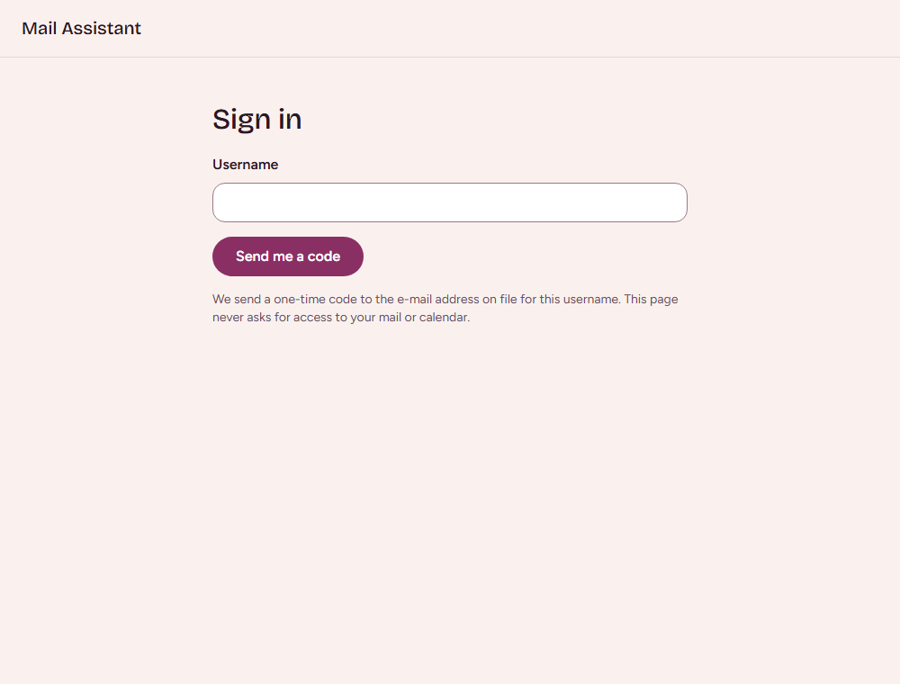
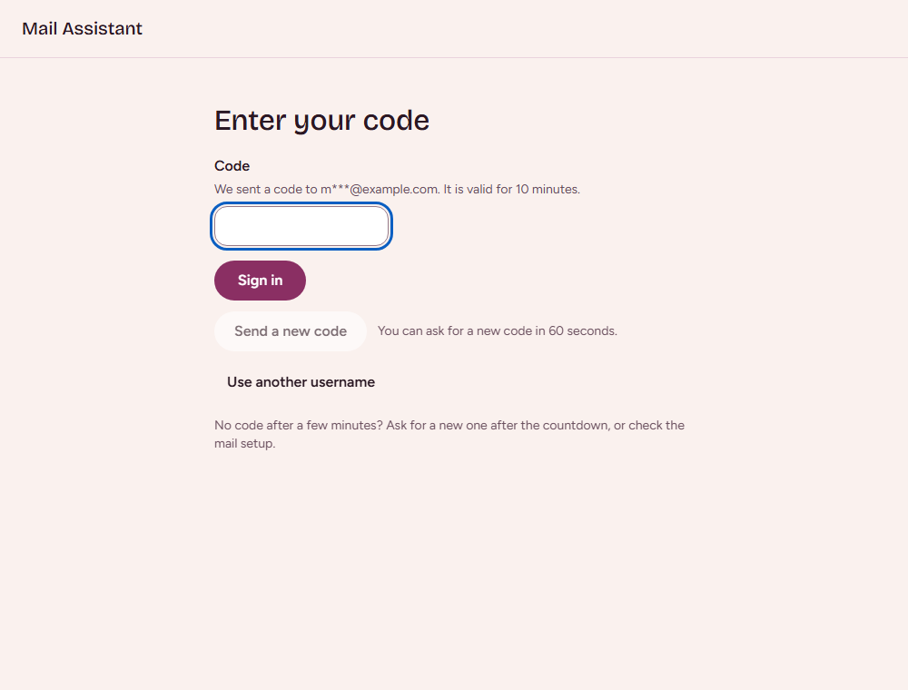
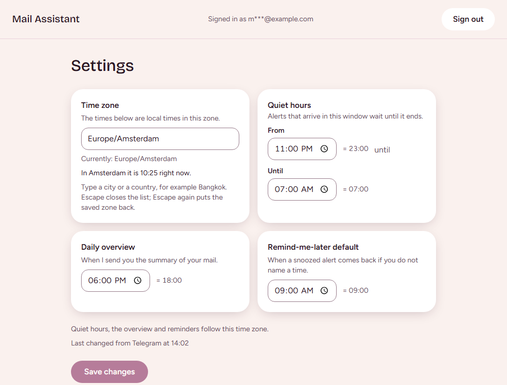
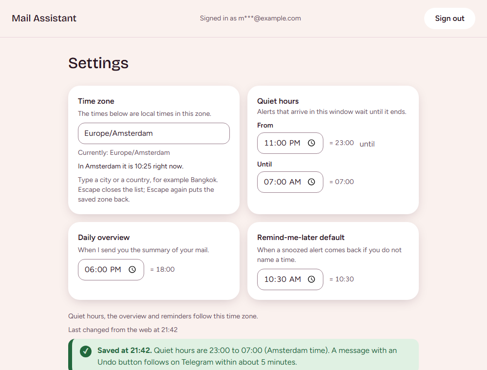
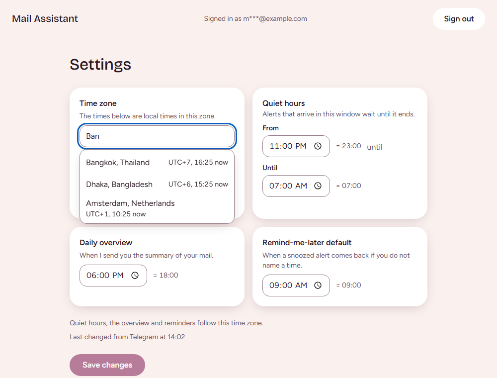
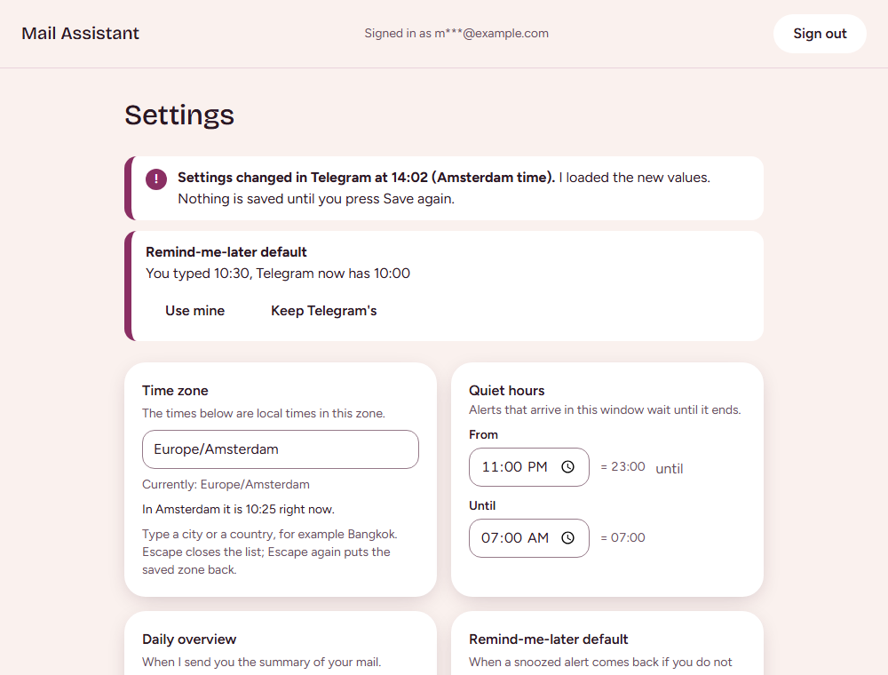

# Change your settings on the web

Sign in on a web page and see or change the same four settings as in Telegram: quiet hours, the daily overview, the remind-me-later default and your time zone. Every change you make on the web is announced in Telegram, where you can undo it.

## Before you start

- You can open the page only from your home network. It is not reachable from outside, so away from home use `/settings` in Telegram instead (see [Quiet hours and other settings in Telegram](quiet-hours.md)).
- You need your username and access to the mailbox that receives the sign-in code. The page shows that address with most letters hidden, for example `m***@example.com`.
- Your phone, tablet or computer must trust the certificate of your home network. If the browser warns about the certificate, do not click through; ask whoever set up the network.
- The examples and pictures below use demo values.

## Sign in

1. Open the page. If you are not signed in you land on **Sign in**.
2. Type your username (not your e-mail address) and choose **Send me a code**. Spaces before or after the name and capital letters do not matter. The page says it sends a one-time code to the e-mail address on file and never asks for access to your mail or calendar.
3. The page changes to **Enter your code**. It names the hidden address the code went to and says the code is valid for 10 minutes.
4. Open the mail "Your Mail Assistant sign-in code". It holds six digits and no link. Type the digits in the **Code** field (spaces are dropped when you paste) and choose **Sign in**.




1. You land on **Settings**. The top of the page shows "Signed in as" with your hidden address, and a **Sign out** button.



A code works once, and only in the browser where you asked for it.

### Messages you may see

| What you see | What it means | What to do |
| --- | --- | --- |
| "Please wait before asking for another code." with the seconds left | A new code can be asked for 60 seconds after the last one. | Wait for the countdown next to **Send a new code**. |
| "You have asked for too many codes this hour." | At most 5 codes can be asked for in an hour. Every request counts, also one whose mail did not arrive. | Wait for the number of minutes the page names. |
| "That code is not right. You have 3 tries left." | Each code allows 5 tries. | Check the digits and try again. |
| "Too many wrong tries." | The code no longer works. | Choose **Send a new code**. |
| "This code has expired." | The code is older than 10 minutes. | Choose **Send a new code**. A new code replaces the old one, which then no longer works. |
| "Could not ask for a code. Check the username and try again." | The request did not go through. | Check the username and try again. |
| "Access refused. This request was not allowed." | The page refused the request. | Choose **Back to sign in**. |

The page gives the same answer whether or not the username is right, so a wrong username looks like a normal code request. If you typed it wrongly no mail arrives; choose **Use another username**.

### When no code arrives

1. Wait a few minutes; delivery can take that long.
2. When the countdown has ended, choose **Send a new code**. Only the newest code works.
3. Check the spam folder, and that you are looking at the mailbox whose hidden address the page names.
4. Check that web sign-in is not locked (see [Lock web sign-in](#lock-web-sign-in)). While it is locked the page behaves as usual but no mail is sent.
5. If it keeps failing, the mail setup of the assistant may be down. The page says: "No code after a few minutes? Ask for a new one after the countdown, or check the mail setup." You can still change your settings in Telegram.

### Sessions

The session ends after 30 minutes without activity, and in any case after 12 hours. When it ends, the page sends you to **Sign in** with "Your session ended. Sign in again." After you sign in you return to **Settings** with the stored values; what you typed but did not save is not kept. Choose **Sign out** to end the session yourself.

## Change your settings

The page shows four cards, in this order:

- **Time zone**: the zone that the three times below are local times in.
- **Quiet hours**, from and until: alerts that arrive in this window wait until it ends.
- **Daily overview**: when the assistant sends the summary of your mail.
- **Remind-me-later default**: when a snoozed alert comes back if you do not name a time.

The page follows the same rules as Telegram. Under the cards a line says who changed the settings last, for example "Last changed from Telegram at 14:02", or "Using the default settings." when nothing has been saved yet.

1. Change a value. **Save changes** becomes available when something differs from what is stored.
2. Choose **Save changes**.
3. A green banner appears: "Saved at 14:05. Quiet hours are 22:00 to 07:00 (Amsterdam time). A message with an Undo button follows on Telegram within about 1 minute." The number is how often the assistant looks for changes; it depends on how the assistant is set up.



A change applies to new alerts only. An alert that was already held keeps its release time.

### Choose a time zone

1. Click the **Time zone** field and type a city or a country, for example `Bangkok`. A list of places appears, each with its offset and the time it is there now.
2. Pick one with the mouse, or with the arrow keys and Enter. Escape closes the list; Escape again puts the saved zone back.
3. A line shows the time in the chosen place right now. Below the cards a preview says what your quiet hours mean in the new zone, for example "Quiet hours will now be 22:00 to 07:00 Bangkok time (16:00 to 01:00 Amsterdam time)." The clock times in the form do not change; only the moment they mean moves.


4. Choose **Save changes**.

If the page finds nothing it says "Nothing found for 'Phuket'. Try the nearest bigger city, or the country." and may offer "Did you mean ...?". If the lookup is down it says so; keep typing or try again in a moment.

### When a value is refused

The reason is shown next to the field, in the words of Telegram, and nothing is saved. Examples: quiet hours must start and end at different times and last 1 to 12 hours; the daily overview and the remind-me-later default may not fall inside quiet hours; a time must be a whole minute such as `09:00`. Fix the field and save again. The first wrong field takes focus.

"Could not save. Nothing was changed." means the request did not go through; choose **Try again**. "Could not load your settings." offers **Try again** too.

### When the settings changed while you were editing

If Telegram or another web page changed the settings after you opened the page, saving does not overwrite them. The page loads the new values and shows a banner such as "Settings changed in Telegram at 14:02 (Amsterdam time). I loaded the new values. Nothing is saved until you press Save again." (or "Settings changed from the web ...").

For every field you had edited that the other change moved as well, the page shows what you typed and what is stored, for example "You typed 22:30, Telegram now has 23:00", with two buttons:

- **Use mine**: put your value back in the form.
- **Keep Telegram's** (**Keep the stored value** when the other change came from the web): keep the stored value.



Nothing is saved until you choose **Save changes** again.

## The message in Telegram

Within one run interval (about a minute) of every change on the web, the assistant sends you one message in Telegram:

```text
Your settings were changed on the web (change 7).
Channel: web. Time: 2026-11-14 14:05 (Europe/Amsterdam)
Quiet hours: 22:00 to 07:00 (was 23:00 to 07:00)
Daily overview: 18:00 (unchanged)
Remind-me-later default: 09:00 (unchanged)
Time zone: Europe/Amsterdam (unchanged)
```

Under it are two buttons. The message is also sent during quiet hours, also those the change itself has just set, and it never replaces a dialogue you are in.

- **Undo** puts the values back as they were before the first web change you had not yet been told about. If you saved three times before the assistant looked, Undo on any of the messages goes back to before the first. The answer is "Undone. The values from before the web changes are back."
- **Undo and lock web sign-in** does the same and also locks web sign-in (below).

If the change was not yours, use the second button.

## Lock web sign-in

Locking web sign-in ends every web session and refuses every sign-in until you lift the lock in Telegram. Telegram's `/settings` is not affected.

- Tap **Undo and lock web sign-in** on a message, or send `/web_lock` in the chat with the assistant at any time. The sign-in mail names this command in case you did not ask for the code. The answer says whether web sign-in was locked now or already was.
- Send `/web_unlock` to allow web sign-in again. The answer is "Web sign-in is unlocked." (or "Web sign-in was not locked. Nothing was changed.").
- While it is locked, the sign-in page still answers as usual; it just never sends a code. It does not say that it is locked.

### The lock sets itself

If the sign-in page gets 5 wrong or expired codes within 10 minutes, the assistant sends you "5 wrong or expired web sign-in codes in the last 10 minutes." with the time in UTC. It sends at most one such message per 10 minutes. After 15 within 24 hours it locks web sign-in itself and sends "15 wrong or expired web sign-in codes in 24 hours. Web sign-in is locked." with the time and the reminder to send `/web_unlock`.

Only wrong, expired or used-up codes count, typed against a code that was really sent for your username. Requests that are malformed or lack the browser's login cookie do not count. The message holds no code and no username. If the assistant restarts, it may count the last 24 hours again and lock once more; send `/web_unlock` again.

## Only on your home network

The page is deliberately not reachable from the internet. Away from home it does not open; use Telegram, which works anywhere. If you can reach the page from outside your home network, tell whoever runs it: that is not intended.

## Related pages

- [Quiet hours and other settings in Telegram](quiet-hours.md)
